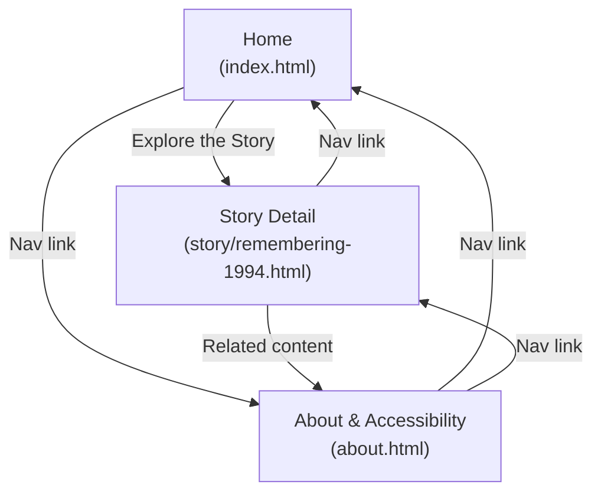

# StoryCast — Sitemap & Information Architecture

StoryCast has exactly **three** main pages, matching the Figma screenshots
provided for this project. No additional pages should be added beyond this
structure.

## Text-based sitemap

```
StoryCast
├── Home — /index.html
│   ├── Utility ribbon + header navigation (Home, Story Detail, About & Accessibility)
│   ├── Hero introduction + placeholder hero image
│   ├── Search / filter preview (disabled — static prototype, no backend/JS)
│   ├── Featured story ("Voices of Survival")
│   ├── Educational Remembrance & Historical Context (3 feature cards)
│   ├── Pull-quote banner
│   ├── Commemoration banner
│   └── Footer
│
├── Story Detail — /story/remembering-1994.html
│   ├── Header navigation
│   ├── Story title + meta (location, date, duration, language)
│   ├── Accessibility controls (Text Scale, Readability Font Mode — CSS-only)
│   ├── Media player (placeholder, prepared for <video>/<audio> + <track>)
│   ├── Transcript + sidebar (archival log, speaker profile, linguistic note)
│   ├── Historical introduction & context
│   ├── Location & archival integrity verification
│   ├── Related content (reserved slots)
│   ├── References
│   ├── Citation block
│   ├── Commemoration banner
│   └── Footer
│
└── About & Accessibility — /about.html
    ├── Header navigation
    ├── About StoryCast + hero image
    ├── Institutional Mandate & Ethical Framework (mission + 3 pillars)
    ├── How to Use This Archive in Education (3 audience cards)
    ├── Working Toward WCAG 2.1 AA (4 accessibility feature cards)
    ├── Historical Sources & References
    ├── Accessibility Barrier Feedback Form (real mailto form)
    ├── Archival Provenance & Advisory Council (4 unfilled seats)
    ├── Commemoration banner
    └── Footer
```

## Mermaid sitemap diagram



## Navigation relationships

- The same primary navigation (`Home`, `Story Detail`, `About &
  Accessibility`) appears in the header of all three pages, so every page is
  reachable from every other page in a single click.
- `index.html` additionally links directly to the story page from its hero
  call-to-action and from its featured-story card, since that is the site's
  primary conversion path.
- `story/remembering-1994.html` links back to `about.html` from its
  references and related-content sections, connecting the detailed story to
  the project's mission, sourcing, and accessibility information.
- The footer on every page repeats the same three links, so navigation is
  available at both the top and bottom of each page without scrolling back
  up.
- All internal links use relative paths (`../` from within `story/`) so the
  site works both locally and once deployed, with no absolute/hard-coded
  domain.

## Why this hierarchy supports visitors

A visitor who wants **history first** can go Home → Story Detail, reading
the historical introduction and context before reaching the media section.
A visitor who wants **audio/video first** can use the "Audio Guide" header
link or the homepage's featured-story media panel, which both jump straight
to the Story Detail page's media section (`#media-player`). A visitor who
wants to **assess trustworthiness before engaging** can go to
`About & Accessibility` first, where the project's mission, sourcing
process, and accessibility status are stated plainly — including what is
*not* yet verified — before they read any testimony.
